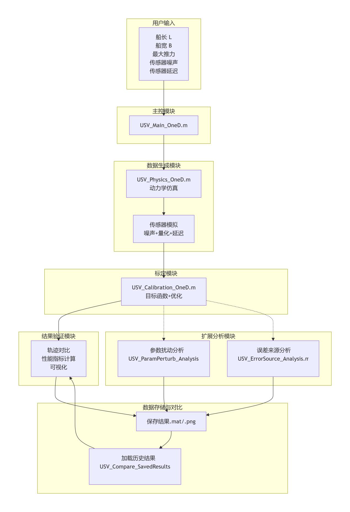
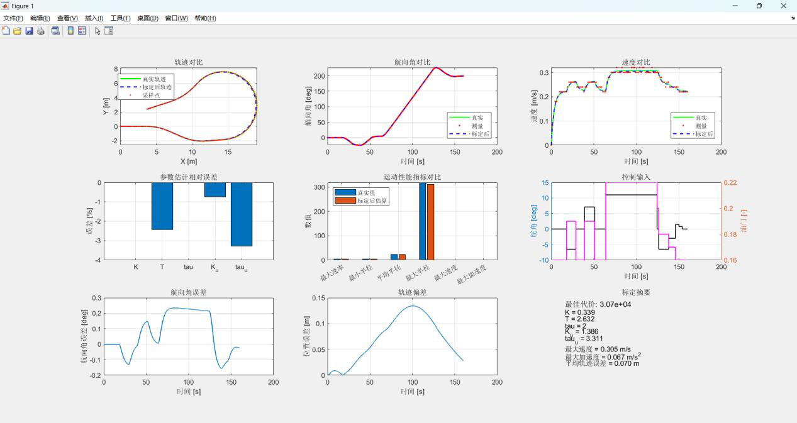
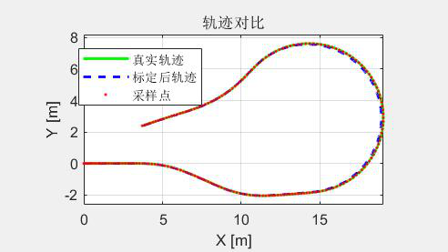
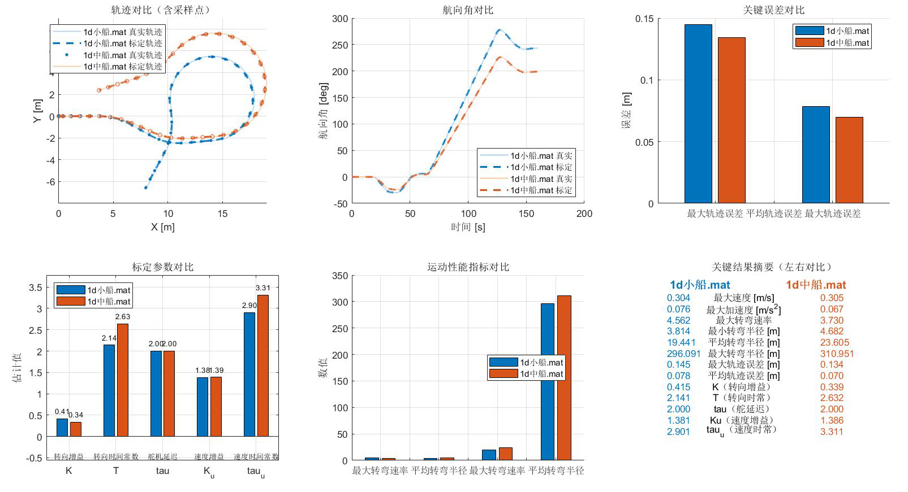
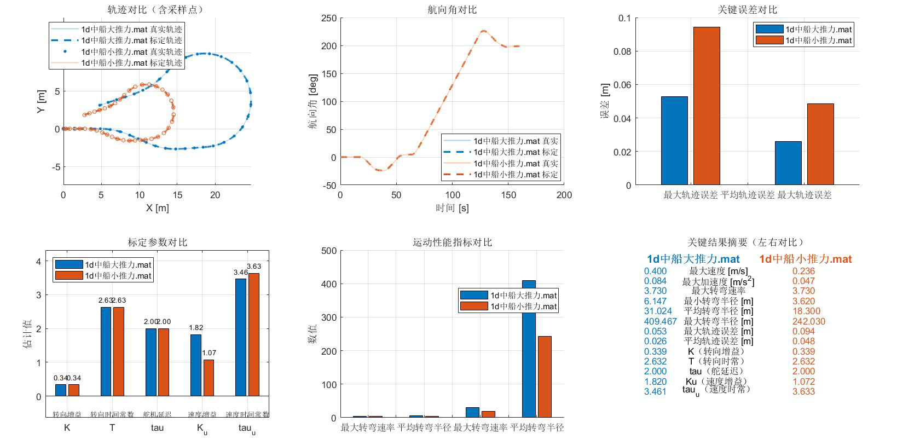
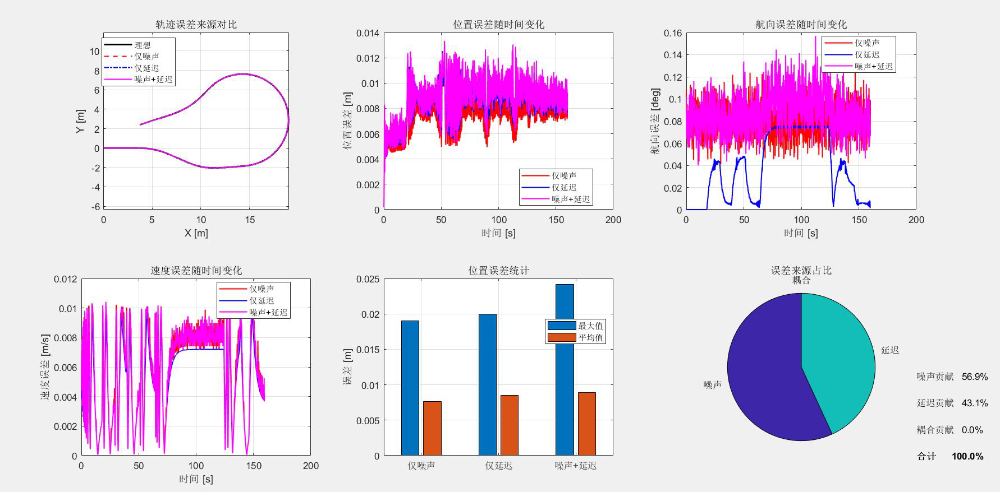

<div align="center">

# USV Digital Twin · Dynamics Modeling & Parameter Identification

**基于 MATLAB 的无人船动力学建模与参数辨识**


*Identifying the unmeasurable hydrodynamic parameters of an unmanned surface vessel from noisy, quantized and delayed sensor data.*

</div>

---

## Overview

Accurate motion models are the backbone of any USV autonomy stack — path following, trajectory tracking, obstacle avoidance, and increasingly **digital twins**. The difficulty is that the parameters which dominate the vessel's dynamics (steering gain, steering and speed time constants) cannot be measured directly. They have to be *identified* from experiment data, and real sea trials are expensive, slow and hard to repeat.

On top of that, low-cost onboard sensing is far from ideal. A MEMS IMU and a GPS receiver introduce **Gaussian noise**, **finite ADC resolution** and **communication/filtering latency** before any data ever reaches the estimation algorithm. Ignoring those effects is what makes textbook identification fail on real hardware.

This project builds a **complete, self-contained MATLAB framework** that reproduces the whole chain — hull geometry and thrust level in, non-ideal sensor measurements through the middle, identified dynamic parameters out — and then validates the result by re-simulating the vessel and comparing trajectories.

It is the parameter-identification stage of a digital-twin pipeline, implemented end to end: **six-domain mapping, weighted inverse estimation, multi-condition validation, sensitivity and error-source decomposition.**

### Highlights

| | |
|---|---|
| **5 parameters identified** | steering gain `K`, steering time constant `T`, rudder servo delay `τ`, speed gain `Ku`, speed time constant `τu` |
| **< 5 % relative error** | on all five parameters under the reference condition |
| **0.070 m** | mean trajectory position error after re-simulation with identified parameters |
| **6-domain mapping chain** | physical → sensor → quantization → algorithm → control → actuator |
| **Multi-condition validation** | 3 hull scales · 3 thrust levels · high-noise · high-delay |
| **Sensitivity + error decomposition** | ranks parameter influence and splits total error by source |
| **Zero extra toolboxes** | runs on base MATLAB R2023b+ (`fminsearch` is a core function) |

---

## Key Results

Reference condition: `L = 2.0 m`, `B = 1.0 m`, `max_thrust = 500 N`, `sensor_noise = 0.1°`, `sensor_delay = 2 steps`, `Δt = 0.01 s`, `T_sim = 160 s`.

### Identified parameters

| Parameter | Meaning | True value | Estimated | Relative error |
|---|---|---|---|---|
| `K` | Steering gain | 0.339 | 0.339 | **−0.0 %** |
| `T` | Steering time constant | 2.698 s | 2.632 s | **−2.4 %** |
| `τ` | Rudder servo delay | 2 steps | 2 steps | **0.0 %** |
| `Ku` | Speed gain | 1.396 | 1.386 | **−0.7 %** |
| `τu` | Speed time constant | 3.424 s | 3.311 s | **−3.3 %** |

### Derived motion performance (true vs. identified model)

| Metric | True | Identified | Error |
|---|---|---|---|
| Max turn rate | 3.73 °/s | 3.73 °/s | −0.0 % |
| Min turning radius | 4.72 m | 4.68 m | −0.7 % |
| Mean turning radius | 23.97 m | 23.61 m | −1.1 % |
| Max turning radius | 319.21 m | 310.95 m | −2.6 % |
| Max speed | 0.307 m/s | 0.305 m/s | −0.7 % |
| Max acceleration | 0.065 m/s² | 0.067 m/s² | +2.6 % |
| **Max trajectory position error** | — | — | **0.134 m** |
| **Mean trajectory position error** | — | — | **0.070 m** |

---

## System Architecture

The framework is split into six independent modules that communicate through `.mat` files and function interfaces, covering the full loop **excitation → simulation → identification → verification**.



| Module | File | Role |
|---|---|---|
| Main controller | `USV_Main_OneD.m` | parameter input, excitation design, module scheduling |
| Dynamics simulation | `USV_Physics_OneD.m` | recursive state propagation (Nomoto + first-order speed lag) |
| Parameter identification | `USV_Calibration_OneD.m` | weighted cost function + `fminsearch` optimization |
| Result comparison | `USV_Compare_SavedResults.m` | cross-condition visualization |
| Parameter perturbation | `USV_ParamPerturb_Analysis.m` | per-parameter sensitivity quantification |
| Error-source analysis | `USV_ErrorSource_Analysis.m` | decomposes error into noise / delay / coupling |

---

## Dynamic Model

A simplified planar model is used — sufficient for low-speed manoeuvring identification and cheap enough for iterative optimization.

**Steering dynamics** — first-order Nomoto model:

```
T · dr/dt + r = K · δ_eff
```

**Speed dynamics** — first-order inertial lag:

```
τu · du/dt + u = Ku · Th
```

**Planar kinematics:**

```
X(k) = X(k−1) + u(k) · cos(ψ(k)) · Δt
Y(k) = Y(k−1) + u(k) · sin(ψ(k)) · Δt
```

`δ_eff` is the rudder angle after the servo delay buffer, `Th` the normalized throttle command in `[0, 1]`.

---

## Multi-Domain Mapping

This is what makes the simulation non-ideal, and what makes the identification problem realistic. Every measurement passes through the same chain a real vessel would impose:

```
Physical domain  →  Sensor domain  →  Quantization  →  Algorithm domain  →  Control  →  Actuator
 (true state)       (Gaussian noise)   (ADC, q=0.02°)  (FIFO delay)          (normalized)  (thrust)
```

| Domain | Model | Implementation |
|---|---|---|
| Sensor | zero-mean Gaussian noise, `σ = 0.1°` heading | `psi + randn(n,1) * sensor_noise` |
| Quantization | effective step `q = 0.02°` (16-bit ADC, ±180° full scale) | `round(x / q) * q` |
| Algorithm | fixed latency via FIFO buffer, 2 steps = 0.02 s | shift-and-fill queue in `USV_Physics_OneD.m` |

Noise magnitude is derived from real hardware figures — a consumer MEMS IMU (e.g. MPU9250) with ≈ 0.1 °/h angle random walk sampled at 100 Hz gives an equivalent heading noise standard deviation of roughly 0.1°.

---

## Parameter Identification

The estimation is formulated as a **nonlinear least-squares problem** solved by the **Nelder-Mead simplex algorithm** (MATLAB's built-in `fminsearch`). A gradient-based method is unsuitable here: the model is nonlinear and the cost function contains a rounding penalty that makes it non-smooth.

**Weighted cost function** — three residuals combined:

| Residual | Weight | Rationale |
|---|---|---|
| Heading angle error | 1.0 | primary observability of steering dynamics |
| Speed error | 64 | anchors the speed channel |
| Angular rate error | 18 | sharpens `T` and `τ` identifiability |

**Time-varying weights** emphasise the informative segments — turning build-up and the sustained arc get 2.2× and 2.8× weight, while straight-running legs stay at 1.0×.

**Penalty terms** keep the solution physically meaningful:

| Penalty | Value | Purpose |
|---|---|---|
| Delay rounding | `5e4` | nudges `τ` toward integer steps |
| Boundary | `1e6` | prevents simplex divergence |
| Weak-turn | `2e4` | rejects degenerate "never turns" solutions |

**Efficiency measures:** 5× downsampling during identification (effective period 0.05 s), `MaxIter = 1200`, `MaxFunEvals = 1800`, `TolX = 1e-4`, `TolFun = 1e-5`. Heading is unwrapped before differentiation to avoid ±180° discontinuities, and the residual is wrapped back into `[−180°, 180°]`.

### Identification result dashboard



### Trajectory validation

The identified parameters are fed back into a clean simulation; the reconstructed trajectory overlays the ground truth, with only minor deviation during turn transitions.



---

## Multi-Condition Validation

### Hull scale (small / medium / large)

Turning gain decreases and the steering time constant increases with hull size — larger vessels respond more slowly, as expected physically. Mean trajectory error stays **≤ 0.08 m** across all three hulls.

| Hull | `K` | `T` | Min turning radius |
|---|---|---|---|
| Small (1.4 m) | 0.415 | 2.141 s | 3.81 m |
| Medium (2.0 m) | 0.339 | 2.632 s | — |
| Large (3.0 m) | 0.268 | 3.347 s | 5.55 m |



### Thrust level (350 / 500 / 750 N)

Speed gain `Ku` rises with thrust (1.072 → 1.820) while the steering parameters `K`, `T`, `τ` remain essentially unchanged — confirming the decoupled steering/speed design assumption. Trajectory error stays **below 0.05 m** in all thrust cases.



### Sensor degradation

- **High noise** (`σ = 1.0°`): measurement scatter grows sharply and identification accuracy degrades — the noise share of total error climbs to **89.7 %**, with error peaks rising from 0.18 m to 1.4 m.
- **High delay** (`10 steps`): a clear phase lag appears in heading measurements, and the identified steering time constant `T` drifts from 2.63 s to ≈ 3.1 s. This confirms that when the sensor delay is known it must be compensated for during pre-processing.

### Parameter sensitivity

Perturbing each parameter by ±10 % and ±20 % and observing the resulting trajectory error gives a clear ranking:

```
K (4.48)  ≫  Ku (1.73)  ≫  T (0.26)  >  τu (0.14)  >  τ (0.01)
```

Steering gain dominates, followed by speed gain. Time-constant errors are tolerated well by the model — useful information when deciding which parameters deserve the tightest identification budget in a real controller design.

### Error-source decomposition

By running three scenarios — noise only, delay only, and both — the total trajectory error is split by source:

| Condition | Noise | Delay | Coupling |
|---|---|---|---|
| Reference (0.1°, 2 steps) | **57 %** | 43 % | negligible |
| High noise (1.0°, 2 steps) | **89.7 %** | 10.3 % | negligible |



**Noise is the dominant error source** — which points directly at the highest-value improvement: sensor fusion or filtering ahead of the identification stage.

---

## Repository Structure

```
usv-digital-twin-matlab/
├── README.md
├── LICENSE
├── .gitignore
├── src/                          # MATLAB source code
│   ├── USV_Main_OneD.m           # entry point / scheduler
│   ├── USV_Physics_OneD.m        # dynamics + sensor non-idealities
│   ├── USV_Calibration_OneD.m    # cost function + fminsearch
│   ├── USV_Compare_SavedResults.m
│   ├── USV_ParamPerturb_Analysis.m
│   ├── USV_ErrorSource_Analysis.m
│   └── plot_param_flow.m         # parameter relation diagram helper
├── data/
│   └── measured_oned.mat         # pre-generated reference measurement set
├── results/                      # saved calibration results per condition
│   ├── small_ship.mat
│   ├── medium_ship.mat
│   ├── large_ship.mat
│   ├── medium_ship_thrust_low.mat / _thrust_high.mat
│   ├── medium_ship_delay_high.mat
│   └── medium_ship_noise_high*.mat / noise_high_3.mat
└── docs/
    └── figures/                  # figures referenced in this README
```

---

## Getting Started

**Requirements:** MATLAB R2023b or later. **No additional toolboxes needed** — `fminsearch` ships with base MATLAB.

```matlab
% 1. enter the source directory
cd src

% 2. run the main script
USV_Main_OneD
```

The script then walks you through the workflow interactively:

1. **Parameter input** — hull length/width, max thrust, sensor noise σ, sensor delay (press Enter to accept the defaults)
2. **Excitation design** — a staged rudder/throttle profile: straight run → down-turn → re-centre → up-turn → re-centre → sustained arc → reverse correction
3. **Ground-truth generation** — physically plausible parameters synthesised from hull scale and thrust level with a fixed random seed (`rng(1234)`) for reproducibility
4. **Measurement generation** — noise, quantization and delay applied; saved as `measured_oned.mat`
5. **Identification** — weighted cost function minimised by `fminsearch`
6. **Verification** — re-simulation, trajectory/metric comparison, error plots, optional hull animation and result export

To compare several saved conditions, run `USV_Compare_SavedResults` and pick two `.mat` files from `results/`.

---

## Tech Stack

`MATLAB` · `System Identification` · `Parameter Estimation` · `Optimization (Nelder-Mead)` · `Control Theory` · `Sensor Modeling` · `Signal Processing`

---

## Limitations & Future Work

This work is deliberately scoped and honest about its boundaries:

- **All validation is simulation-based.** The framework was not verified against real vessel data. Closing that gap — mounting an IMU + GPS on an actual hull, following a designed excitation route, and identifying the real parameters from collected data — is the natural next step. Those parameters can then feed controller tuning and a higher-fidelity digital twin.
- **The model is simplified** (first-order Nomoto + first-order speed lag, decoupled channels). Environmental disturbance — wind, waves, current — is not modelled.
- **Local optimization.** `fminsearch` can be sensitive to the initial guess; global methods (particle swarm, genetic algorithms) are a promising extension for wider basins of attraction.
- **Future directions:** online adaptive identification, finer hydrodynamic models, and co-operation with research institutions to obtain sea-trial datasets.

---

## Author

**王译 (Yi Wang)**
Electronic Information Engineering, School of Information and Communication Engineering
Hainan University

📧 2440643719@qq.com

---

<div align="center">
<sub>Undergraduate graduation thesis project · Hainan University · 2026</sub>
</div>

<br>

---

<div align="center">

# 中文版

</div>

---

## 项目简介

无人船（USV）的运动模型是路径跟踪、轨迹控制与避障功能的基础，也是构建**数字孪生**系统的核心组成部分。难点在于：真正决定船体动态特性的那几个参数——转向增益、转向时间常数、速度时间常数——**无法直接测量**，只能通过实验数据反向辨识；而实船试验成本高、周期长、难以重复。

与此同时，低成本船载传感器远非理想。MEMS IMU 与 GPS 在数据进入估计算法之前，就已经引入了**高斯噪声**、**ADC 有限分辨率量化误差**和**滤波/通信延迟**。忽略这些非理想环节，正是教科书式辨识方法在真实硬件上失效的原因。

本项目在 MATLAB 中搭建了一套**完整自洽的仿真框架**，复现了从船体几何与推力输入、经非理想测量链路、到逆向辨识出动力学参数的全过程，并通过重新仿真对比轨迹来验证辨识结果的可靠性。

这是数字孪生流程中**参数辨识环节**的一次端到端实现：**多域映射、加权逆向估计、多工况验证、参数敏感度与误差来源分解。**

### 项目亮点

| | |
|---|---|
| **辨识 5 个动力学参数** | 转向增益 `K`、转向时间常数 `T`、舵机延迟 `τ`、速度增益 `Ku`、速度时间常数 `τu` |
| **误差均小于 5%** | 基准工况下五个参数的估计相对误差 |
| **0.070 m** | 用辨识参数重新仿真后的轨迹平均位置误差 |
| **六域映射链路** | 物理域 → 传感器域 → 量化域 → 算法域 → 控制域 → 执行域 |
| **多工况验证** | 3 种船型 · 3 种推力 · 高噪声 · 高延迟 |
| **敏感度 + 误差分解** | 量化各参数影响力，并按来源拆分总误差 |
| **零额外工具箱** | 仅需 MATLAB R2023b+ 基础安装（`fminsearch` 为核心函数） |

---

## 关键结果

基准工况：`L = 2.0 m`，`B = 1.0 m`，`max_thrust = 500 N`，`sensor_noise = 0.1°`，`sensor_delay = 2 步`，`Δt = 0.01 s`，`T_sim = 160 s`。

### 参数辨识结果

| 参数 | 含义 | 真实值 | 估计值 | 相对误差 |
|---|---|---|---|---|
| `K` | 转向增益 | 0.339 | 0.339 | **−0.0 %** |
| `T` | 转向时间常数 | 2.698 s | 2.632 s | **−2.4 %** |
| `τ` | 舵机延迟 | 2 步 | 2 步 | **0.0 %** |
| `Ku` | 速度增益 | 1.396 | 1.386 | **−0.7 %** |
| `τu` | 速度时间常数 | 3.424 s | 3.311 s | **−3.3 %** |

### 运动性能指标（真实模型 vs. 辨识模型）

| 指标 | 真实值 | 估计值 | 误差 |
|---|---|---|---|
| 最大转弯速率 | 3.73 °/s | 3.73 °/s | −0.0 % |
| 最小转弯半径 | 4.72 m | 4.68 m | −0.7 % |
| 平均转弯半径 | 23.97 m | 23.61 m | −1.1 % |
| 最大转弯半径 | 319.21 m | 310.95 m | −2.6 % |
| 最大速度 | 0.307 m/s | 0.305 m/s | −0.7 % |
| 最大加速度 | 0.065 m/s² | 0.067 m/s² | +2.6 % |
| **轨迹最大位置误差** | — | — | **0.134 m** |
| **轨迹平均位置误差** | — | — | **0.070 m** |

---

## 系统架构

框架拆分为六个相互独立的模块，通过 `.mat` 文件与函数接口通信，完整覆盖 **激励 → 仿真 → 辨识 → 验证** 这一主线。


| 模块 | 文件 | 作用 |
|---|---|---|
| 主控模块 | `USV_Main_OneD.m` | 参数输入、激励信号构造、模块调度 |
| 动力学仿真 | `USV_Physics_OneD.m` | 递推状态量（Nomoto + 一阶惯性速度模型） |
| 参数辨识 | `USV_Calibration_OneD.m` | 加权代价函数 + `fminsearch` 参数寻优 |
| 结果对比 | `USV_Compare_SavedResults.m` | 多工况结果横向对比可视化 |
| 参数扰动分析 | `USV_ParamPerturb_Analysis.m` | 各参数敏感度量化 |
| 误差来源分析 | `USV_ErrorSource_Analysis.m` | 把总误差分解为噪声 / 延迟 / 耦合项 |

---

## 动力学模型

采用简化的平面运动模型——对低速操纵性辨识而言精度足够，且计算代价低，适合嵌入迭代优化。

**转向动态** —— 一阶 Nomoto 模型：

```
T · dr/dt + r = K · δ_eff
```

**速度动态** —— 一阶惯性模型：

```
τu · du/dt + u = Ku · Th
```

**平面运动学：**

```
X(k) = X(k−1) + u(k) · cos(ψ(k)) · Δt
Y(k) = Y(k−1) + u(k) · sin(ψ(k)) · Δt
```

其中 `δ_eff` 为经过舵机延迟缓冲后的有效舵角，`Th` 为归一化油门指令，取值 `[0, 1]`。

---

## 多域映射

这是让仿真"非理想"、让辨识问题贴近真实的关键设计。每一路测量数据都要经过与真实船舶相同的转换链路：

```
物理域  →  传感器域  →  量化域  →  算法域  →  控制域  →  执行域
(真实状态)  (高斯噪声)   (ADC, q=0.02°)  (FIFO延迟)   (归一化)   (推力)
```

| 域 | 模型 | 代码实现 |
|---|---|---|
| 传感器域 | 零均值高斯噪声，航向 `σ = 0.1°` | `psi + randn(n,1) * sensor_noise` |
| 量化域 | 有效量化步长 `q = 0.02°`（16 位 ADC，量程 ±180°） | `round(x / q) * q` |
| 算法域 | FIFO 缓冲队列模拟固定延迟，2 步 = 0.02 s | `USV_Physics_OneD.m` 中的移位填充队列 |

噪声量级并非凭空设定，而是来自真实器件指标：消费级 MEMS IMU（如 MPU9250）在 100 Hz 采样下，约 0.1 °/h 的角度随机游走等效出约 0.1° 的航向噪声标准差。

---

## 参数辨识算法

辨识问题被表述为一个**非线性最小二乘问题**，用 **Nelder-Mead 单纯形法**（MATLAB 内置 `fminsearch`）求解。这里不适合用梯度类方法：模型本身非线性，且代价函数包含取整惩罚项，导致其不可导。

**加权代价函数** —— 三项残差联合约束：

| 残差 | 权重 | 作用 |
|---|---|---|
| 航向角误差 | 1.0 | 转向动态的主要可观测量 |
| 速度误差 | 64 | 锚定速度通道 |
| 角速度误差 | 18 | 提升 `T` 与 `τ` 的可辨识性 |

**时变权重**进一步强化信息量大的区段——转向建立段与持续圆弧段分别取 2.2 倍和 2.8 倍权重，直行段保持 1.0 倍。

**惩罚项**保证解的物理合理性：

| 惩罚项 | 系数 | 作用 |
|---|---|---|
| 延迟取整惩罚 | `5e4` | 把 `τ` 拉向整数步 |
| 边界惩罚 | `1e6` | 防止单纯形跑飞 |
| 弱转弯惩罚 | `2e4` | 排除"几乎不转弯"的伪解 |

**效率措施：** 辨识阶段 5 倍降采样（等效采样周期 0.05 s）；`MaxIter = 1200`，`MaxFunEvals = 1800`，`TolX = 1e-4`，`TolFun = 1e-5`。航向角先解缠（unwrap）再求差分，避免跨越 ±180° 时误差炸裂；残差再 wrap 回 `[−180°, 180°]`。

### 标定结果总览


### 轨迹验证

把辨识出的参数代回无污染的仿真中重新推演，重建轨迹与真实轨迹基本重合，仅在转弯过渡段存在微小偏差。


---

## 多工况验证

### 不同船型（小 / 中 / 大）

随船长增大，转向增益下降、转向时间常数上升——大船转向灵敏度更低、响应更迟缓，与物理预期一致。三种船型的轨迹平均位置误差均 **≤ 0.08 m**。

| 船型 | `K` | `T` | 最小转弯半径 |
|---|---|---|---|
| 小船（1.4 m） | 0.415 | 2.141 s | 3.81 m |
| 中船（2.0 m） | 0.339 | 2.632 s | — |
| 大船（3.0 m） | 0.268 | 3.347 s | 5.55 m |


### 不同推力（350 / 500 / 750 N）

速度增益 `Ku` 随推力增大而上升（1.072 → 1.820），而转向参数 `K`、`T`、`τ` 基本不变——这与模型中转向/速度解耦的设计假设完全吻合，说明系统行为可靠。各推力工况下轨迹平均位置误差均 **小于 0.05 m**。


### 传感器退化

- **高噪声**（`σ = 1.0°`）：测量数据剧烈波动，辨识精度明显下降——噪声对总误差的贡献占比升至 **89.7 %**，误差峰值从 0.18 m 增大到 1.4 m。
- **高延迟**（`10 步`）：航向测量出现明显相位滞后，辨识出的转向时间常数 `T` 从 2.63 s 漂移到约 3.1 s。这印证了一个工程结论：**当传感器延迟已知时，必须在数据预处理阶段做对齐补偿。**

### 参数敏感度

对每个参数施加 ±10% 与 ±20% 扰动，观察轨迹误差变化，得到清晰的敏感度排序：

```
K (4.48)  ≫  Ku (1.73)  ≫  T (0.26)  >  τu (0.14)  >  τ (0.01)
```

转向增益 `K` 的敏感度远高于其他参数，说明**保证 `K` 的辨识精度对轨迹跟踪精度最关键**；速度增益 `Ku` 次之。时间常数类参数影响较小，模型对其误差有较好的包容度——这为后续模型简化和控制器设计提供了量化依据。

### 误差来源分解

通过构造"仅含噪声""仅含延迟""同时含两者"三种仿真场景，将总轨迹误差按来源拆分：

| 工况 | 噪声 | 延迟 | 耦合项 |
|---|---|---|---|
| 基准工况（0.1°, 2 步） | **57 %** | 43 % | 可忽略 |
| 高噪声工况（1.0°, 2 步） | **89.7 %** | 10.3 % | 可忽略 |


**噪声是系统的主要误差来源**——这也直接指出了最有价值的改进方向：在辨识环节之前引入传感器融合或滤波。

---

## 仓库结构

```
usv-digital-twin-matlab/
├── README.md
├── LICENSE
├── .gitignore
├── src/                          # MATLAB 源码
│   ├── USV_Main_OneD.m           # 入口 / 调度
│   ├── USV_Physics_OneD.m        # 动力学 + 传感器非理想特性
│   ├── USV_Calibration_OneD.m    # 代价函数 + fminsearch
│   ├── USV_Compare_SavedResults.m
│   ├── USV_ParamPerturb_Analysis.m
│   ├── USV_ErrorSource_Analysis.m
│   └── plot_param_flow.m         # 参数关系图绘制工具
├── data/
│   └── measured_oned.mat         # 预生成的基准工况测量数据
├── results/                      # 各工况保存的标定结果
│   ├── small_ship.mat
│   ├── medium_ship.mat
│   ├── large_ship.mat
│   ├── medium_ship_thrust_low.mat / _thrust_high.mat
│   ├── medium_ship_delay_high.mat
│   └── medium_ship_noise_high*.mat / noise_high_3.mat
└── docs/
    └── figures/                  # 本 README 引用的图表
```

---

## 快速开始

**环境要求：** MATLAB R2023b 或更高版本。**无需任何额外工具箱**——`fminsearch` 属于 MATLAB 基础函数。

```matlab
% 1. 进入源码目录
cd src

% 2. 运行主程序
USV_Main_OneD
```

程序会以交互方式引导完整流程：

1. **参数输入** —— 船长/船宽、最大推力、传感器噪声 σ、延迟步数（直接回车即用默认值）
2. **激励信号设计** —— 分阶段舵角/油门曲线：直行 → 下偏 → 回正 → 上偏 → 回正 → 持续圆弧 → 反向修正
3. **真实参数生成** —— 依据船体尺度与推力水平按经验公式生成物理合理的参数，固定随机种子（`rng(1234)`）保证可复现
4. **测量数据生成** —— 施加噪声、量化与延迟，保存为 `measured_oned.mat`
5. **参数辨识** —— 加权代价函数经 `fminsearch` 迭代寻优
6. **结果验证** —— 重新仿真、轨迹与指标对比、误差曲线绘制，可选播放船体运动动画并导出结果

若要对比多组工况，运行 `USV_Compare_SavedResults`，从 `results/` 中选择两个 `.mat` 文件即可。

---

## 技术栈

`MATLAB` · `系统辨识` · `参数估计` · `最优化（Nelder-Mead）` · `控制理论` · `传感器建模` · `数字信号处理`

---

## 局限与后续工作

本项目对自身边界保持诚实：

- **全部验证均在仿真环境中完成**，尚未经过实船数据检验。补上这一环——在真实船体上安装 IMU 与 GPS，按设计的激励路线航行采集数据，再用辨识算法反推出该船的真实动力学参数——是最自然的下一步。这些参数可用于控制器参数整定，并进一步建立该船的数字孪生模型。
- **模型经过简化**（一阶 Nomoto + 一阶惯性速度模型、转向与速度解耦），未纳入风、浪、流等环境扰动。
- **局部优化**：`fminsearch` 对初值有一定敏感性，引入粒子群、遗传算法等全局优化方法有望扩大收敛域。
- **后续方向**：在线自适应参数辨识、更精细的水动力模型，以及与相关研究机构合作获取实船试验数据。

---

## 作者

**王译**
海南大学 信息与通信工程学院 · 电子信息工程

📧 2440643719@qq.com

---

<div align="center">
<sub>本科毕业设计 · 海南大学 · 2026</sub>
</div>

<br>

<details>
<summary><b>附录 · 完整图表索引（34 张，均取自毕业论文）</b></summary>

<br>

| 图号 | 文件 | 内容 |
|:---:|---|---|
| 1-3 | `fig1-3_research_features.png` | 研究特色总结 |
| 2-1 | `fig2-1_multidomain_flow.png` | 多域转换流程图 |
| 2-2 | `fig2-2_digital_twin_concept.png` | 无人船数字仿真概念图 |
| 2-3 | `fig2-3_identification_methods.png` | 常见参数辨识方法对比 |
| 2-4 | `fig2-4_param_scale_relation.png` | 船型尺度与参数关系示意图 |
| 3-1 | `fig3-1_sensor_module_flow.png` | 传感器模拟模块数据流图 |
| 3-2 | `fig3-2_calibration_sequence.png` | 参数辨识流程时序图 |
| 3-3 | `fig3-3_system_architecture.png` | 仿真系统总体结构框图 |
| 3-4 | `fig3-4_dynamics_block.png` | 动力学模型结构框图 |
| 3-5 | `fig3-5_coordinate_kinematics.png` | 坐标系与运动学关系示意图 |
| 3-6 | `fig3-6_steering_step_response.png` | 转向动态阶跃响应 |
| 3-7 | `fig3-7_speed_step_response.png` | 速度动态阶跃响应 |
| 3-8 | `fig3-8_downsampling_weighting.png` | 降采样与加权策略示意图 |
| 3-9 | `fig3-9_optimization_flow.png` | 参数辨识算法优化迭代流程图 |
| 4-1 | `fig4-1_input_panel.png` | 参数输入面板 |
| 4-2 | `fig4-2_excitation_signal.png` | 激励信号设计图 |
| 4-3 | `fig4-3_param_generation.png` | 参数生成关系图 |
| 4-4 | `fig4-4_heading_measurement.png` | 航向角测量数据示例 |
| 4-5 | `fig4-5_speed_measurement.png` | 速度测量数据示例 |
| 4-6 | `fig4-6_optimization_iteration.png` | 参数辨识优化迭代过程 |
| 4-7 | `fig4-7_calibration_dashboard.png` | 标定后输出结果总览 |
| 4-8 | `fig4-8_trajectory_comparison.png` | 轨迹对比 |
| 4-11 | `fig4-11_performance_metrics.png` | 运动性能指标计算 |
| 4-12 | `fig4-12_heading_position_error.png` | 航向角误差与位置误差 |
| 4-13 | `fig4-13_calibration_summary.png` | 标定摘要（控制台输出） |
| 5-1 | `fig5-1_ship_size_comparison.png` | 小船与中船标定辨识结果对比 |
| 5-2 | `fig5-2_large_vs_medium.png` | 大船与中船标定辨识结果对比 |
| 5-3 | `fig5-3_thrust_comparison.png` | 默认船型不同推力结果比较 |
| 5-4 | `fig5-4_high_noise.png` | 高噪声情况下的标定结果 |
| 5-5 | `fig5-5_high_delay.png` | 高延迟工况下标定结果 |
| 5-6 | `fig5-6_param_perturbation.png` | 参数扰动影响 |
| 5-7 | `fig5-7_error_source_default.png` | 默认工况下误差来源分析 |
| 5-8 | `fig5-8_error_source_high_noise.png` | 高噪声工况下误差来源分析 |
| 6-1 | `fig6-1_research_logic.png` | 研究内容逻辑关系图 |

</details>
